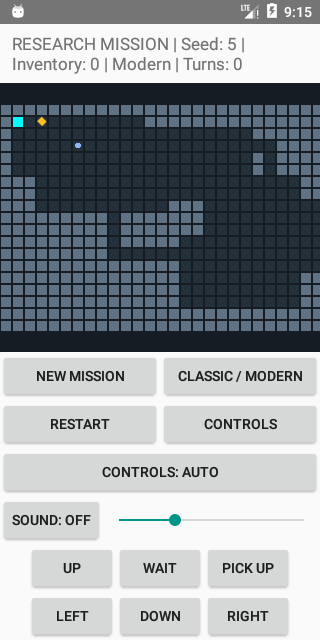

# Playable research mission

Version `0.2-integration` connects recovered routines to the Android app and a
portable playable scenario. Fresh installs start a research mission. If an older
save opens the legacy demo, press **New mission** to start the new scenario.

Move right twice from the starting position to reach the gold sample, then
press **PICK UP**. Inventory changes from 0 to 1 and the action consumes one
prototype turn. The sample disappears from the floor. Restart recreates the same
seed; New mission selects the next seed. Pinch to zoom; the mission camera keeps
the player visible. Classic/Modern, accessible cells/actions, sound controls,
WAIT and the existing save/lifecycle paths remain available.

The map has 67 columns and 19 rows, connected rooms/corridors, one sample and two
blue markers. The markers are authored landmarks, not implemented stairs or
mission transitions. The prototype is not a faithful original-game reconstruction.



Screenshot of the authored scenario in Modern presentation; it contains no
historical game artwork.

## Code that now executes in the app

| Live operation | Recovered implementation | Authored input or policy |
| --- | --- | --- |
| Seeded layout construction | `ShuffledLcgModel` initializer and draws | Room/corridor algorithm, seed fallback 1 and room dimensions |
| Full grid conversion | `LevelGridConversionModel` over all 1,273 cells | Floor/wall glyphs 32/35, markers 94/118, tuning/context and zeroed records |
| Sample creation and placement | `SuppliedRecordPlacementModel` including recovered factory/follow-up selection and `LinkedRecordModel::attach12` | A synthetic type-0 template, supplied handle and fixed sample position (3,1) |
| Sample collection | `LinkedRecordModel::unlink12` | Player must occupy the sample cell; detached sample becomes the single carried object |
| Movement and WAIT | Live `PrototypeGame` state | Destination raw kind 0 is traversable; walls block; successful movement, WAIT and pickup consume one turn |

The grid and record data determine the displayed map and sample presence; these
calls are not a parallel diagnostic run. Collision, diagonal corner behavior,
turn costs, room topology and sample meaning are authored integration rules.
They are not newly verified original movement, inventory or generation rules.
Original data, graphics, sound and instruction emulation are not shipped.

The other research models remain available for further integration. This change
does not implement combat, AI, original mission objectives, stairs or a complete
inventory. It does not enable unsupported factory branches or original allocation.

## State and compatibility

The legacy `MTDEMO 0/1` formats still load and keep their original demo mode.
Research missions use CRC-protected `MTDEMO 2`, containing seed, player, turns,
presentation and an `RM1` world payload with sample possession and all 103 RNG
state words. The immutable authored scenario is regenerated from its seed and
its complete RNG state is checked before restoring possession through the same
unlink operation. Movement/WAIT/pickup do not consume additional RNG in this slice.

`RM1` is a versioned generation recipe. Future changes to generation or RNG use
must preserve this recipe or provide an explicit migration; they must not silently
reinterpret old saves. This is not compatibility with proprietary original saves.
The old APK cannot read the new version-2 mission format. Android continues using
app-private atomic saves, and invalid in-memory loads preserve the existing game.

The C ABI remains version 1 with additive `mt_game_create_research`,
`mt_game_is_research`, `mt_game_pickup` and `mt_game_inventory_count` functions.
Existing callers using `mt_game_create(width,height,seed)` retain legacy behavior.
The terminal host starts the research mission and adds G to collect and N for a
new seed. The SDL host retains its existing default demo in this increment.

## Local verification

```sh
sh scripts/test_local.sh
cmake -S . -B dist/sanitizers -DCMAKE_BUILD_TYPE=Debug -DMT_ENABLE_SANITIZERS=ON
cmake --build dist/sanitizers --parallel 4
ctest --test-dir dist/sanitizers --output-on-failure
# With SDL2 development files discoverable:
cmake -S . -B dist/sdl -DMT_BUILD_SDL_HOST=ON -DCMAKE_BUILD_TYPE=Debug
cmake --build dist/sdl --parallel 4
ctest --test-dir dist/sdl --output-on-failure
gradle -p android :app:assembleDebug :app:assembleDebugAndroidTest :app:lintDebug
```

Native checks include 65 seeded connected layouts, complete cell/record state,
fixed sample access, exact full-RNG save restoration, corruption and every RNG
word's modification, locale independence, C ABI ownership/error handling, legacy
loads and saturated turn rejection. The new mission instrumentation tests are
separate from the 19 legacy-demo UI regressions, which use an explicit legacy
save fixture while retaining their previous assertions.

GitHub Actions remains disabled. Per-PR results identify actual APK/test hashes,
platform, test counts and runtime checks; a build is separate from device testing.

## Verified integration checkpoint — 2026-10-30

Local validation passed **84 Python tests with zero skips**, all native/demo
smoke checks, **33/33 ASan/UBSan** and **34/34 SDL** CTest checks. Frozen map and
save fingerprints were then added for five RM1 seeds; the integration target was
rebuilt and passed under both configurations. These fingerprints require an
explicit recipe/migration decision when layout or persisted RNG behavior changes.

Android debug/test assembly and debug lint passed using Java 17, Gradle 8.7,
SDK/target 35, build-tools 35.0.0, NDK 27.2.12479018 and CMake 3.22.1.
The debug APK is **4,317,860 bytes**, version code **2**, version name
**0.2-integration**, package `org.missionthunderbolt.prototype`, min API 23,
containing arm64-v8a, armeabi-v7a, x86 and x86_64 native libraries.

APK SHA256:
`82f11c46fe4a99d9b97235c187cc59d03a7efecb67469332314dc413a2fa0612`.
Test APK: 28,030 bytes, SHA256
`b38c9805d758aec1ceffcf5c426cf99bf5b607b834e2e15a46cdf1c22d979941`.

Installed APK pulls matched both identities. **22 instrumentation tests passed**
in **39.095 runner seconds** on Android 6.0/API 23 x86_64, measured font 1.0,
portrait, target 35: 19 explicit legacy-demo regressions and 3 new mission tests.
The mission checks cover map dimensions/item accessibility, move/pickup/turns,
recreation/restart state and zoom-camera/accessibility actions. This is the new
APK's result, not a reused result from the earlier prototype.

The software emulator used SwiftShader without KVM. Physical ARM64 output,
current-API runtime qualification, performance acceptance and original-game
fidelity remain unverified. No release signing, Actions run or publication was
performed. Build outputs and detailed device reports remain ignored.

Portrait toolbar actions use two columns so labels remain readable on a 320 px
screen. Final artifact evidence uses the corrected toolbar APK identified above.

A manual touch run on that final APK started seed 5, moved right twice and
collected the sample: Inventory 1, Turns 3. Home triggered an app-private
`MTDEMO 2` save; force-stop and relaunch preserved seed 5, Inventory 1, Modern
presentation and Turns 3. The application crash buffer was empty. Before,
after-pickup and restored screenshots were inspected; the final portrait toolbar
labels are readable and the sample marker disappears after collection. Raw
screenshots/runner/device reports are under ignored `dist/verification/`.
