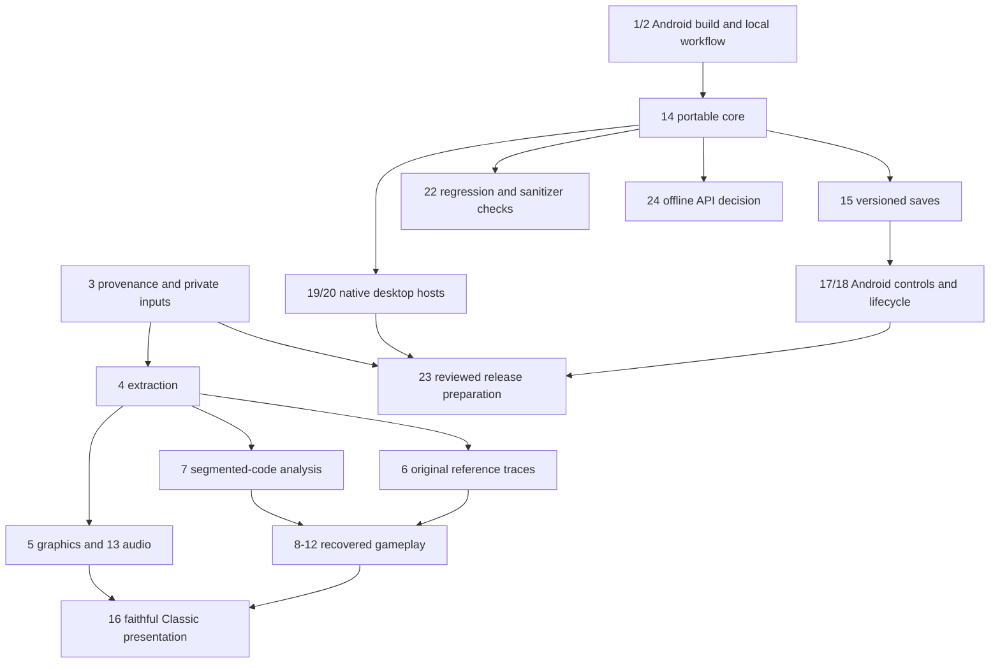

# Mission Thunderbolt roadmap and issue checkpoints

This is a **synthetic native prototype**, not a faithful original-game port.
Work proceeds on `feature/offline-research-tooling`, with `develop` as integration
and `main` release-only. Commits are separately reviewable. Closures of #2, #4, #5, #24 and #25 were verified through the live GitHub API;
Implementation PRs through [#37](https://github.com/pizzaexperiments/missionthunderbolt/pull/37) were verified merged into develop. All five GitHub Actions workflows are disabled during the maintainer-requested
pause. Local test results belong in PRs; no CI run/public release is claimed here.

## Dependency order

## Issue-by-issue state

| Issue | Implemented/researched checkpoint | Remaining acceptance / evidence |
| --- | --- | --- |
| [#1](https://github.com/pizzaexperiments/missionthunderbolt/issues/1) | Pinned selected SDK/NDK/CMake/build-tools, verified local APK and manual artifact checks | Green CI run and uploaded Actions artifact still pending; no automatic runs |
| [#2](https://github.com/pizzaexperiments/missionthunderbolt/issues/2) | Android setup/install/launch guide; clean tracked-source export built on Linux; emulator install/launch tested | Closed as completed: clean Linux clone and documented install/launch satisfy the issue; native platforms/device breadth remain in #18–#20 |
| [#3](https://github.com/pizzaexperiments/missionthunderbolt/issues/3) | Provenance boundaries, private import/index guard; maintainer selected MIT for new code | Historical redistribution rights remain ungranted; current rights-holder/permission research |
| [#4](https://github.com/pizzaexperiments/missionthunderbolt/issues/4) | StuffIt decoded locally; AppleDouble/resource parser produced 1,571 hash-linked entries, including 15 CODE/13 CREL | Closed as completed; source difference documented; implementation merged through PR #26 |
| [#5](https://github.com/pizzaexperiments/missionthunderbolt/issues/5) | 908 resource PICTs + 26 standalone slides decoded; PNG catalogs/contact sheets, indexed 1/4/8-bit fixtures | All 934 pictures match at least one external decoder; four panel roles visually attributed. Closed as completed: decoder/catalog scope; runtime presentation remains #16 |
| [#6](https://github.com/pizzaexperiments/missionthunderbolt/issues/6) | Evidence-labeled trace validator, capture protocol, manual evidence notes | Lawful original reference environment/recordings; executable 2.0.g differs from manual 1.0 |
| [#7](https://github.com/pizzaexperiments/missionthunderbolt/issues/7) | 28 Ghidra imports; 788 jump entries; 8,697 static call candidates; trap-frontier hypotheses; isolated RNG/grid-helper/selector instruction checks | DREL data initialization corroborated; CREL/runtime addressing, full trap/state/scheduler roles, RNG lifecycle and gameplay corroboration |
| [#8](https://github.com/pizzaexperiments/missionthunderbolt/issues/8) | RNG/grid/selector/fallback models; startup/lifecycle checks, 1,600 byte-preparation cases; 49 glyphs, connected 188-map/239,324-cell traversal with original RNG | Recover and implement original generator/progression with golden traces |
| [#9](https://github.com/pizzaexperiments/missionthunderbolt/issues/9) | Manual-backed WAIT; signed-byte coordinate clip and candidate gate checked against original instructions | Original turn/FOV/collision/running implementation and differential tests |
| [#10](https://github.com/pizzaexperiments/missionthunderbolt/issues/10) | Manual combat/wield/exchange evidence recorded | Damage/hit/RNG/weapon rules and original comparisons |
| [#11](https://github.com/pizzaexperiments/missionthunderbolt/issues/11) | Manual quantity/container/equipment evidence; raw filter/list removal/release/prefix models and connected selector checks corroborated | Original schemas, constraints, effects and verified transitions |
| [#12](https://github.com/pizzaexperiments/missionthunderbolt/issues/12) | AI/spawning evidence gaps documented | Controlled original traces, recovered entity/AI/pathfinding logic |
| [#13](https://github.com/pizzaexperiments/missionthunderbolt/issues/13) | 137 single-buffer previews plus one sample-only; timed commands preserved; opt-in authored PCM controls | Opt-in authored Android PCM path added; historical sequence/cue fidelity and physical output remain open |
| [#14](https://github.com/pizzaexperiments/missionthunderbolt/issues/14) | Separate bounded map/seeded RNG, portable CMake, stable C ABI errors/ownership and C-client test | Windows/macOS matrix execution; future recovered systems must remain independent of rendering |
| [#15](https://github.com/pizzaexperiments/missionthunderbolt/issues/15) | Versioned synthetic state, CRC32, migration/corruption/continuation tests and app-private atomic storage | Extend format only as real gameplay systems exist; no proprietary-save compatibility claim |
| [#16](https://github.com/pizzaexperiments/missionthunderbolt/issues/16) | Original graphics available privately for research; reference requirements identified | Faithful Classic layout/menus/fonts/resource mapping and screenshot comparisons; current skins are demo-only |
| [#17](https://github.com/pizzaexperiments/missionthunderbolt/issues/17) | Shared-state skins, persistent Auto/Left/Right controls, virtual accessible map cells/actions, zoom, keyboard/joystick and 17-test runtime regressions | Physical TalkBack usability, physical gamepad and broader device testing |
| [#18](https://github.com/pizzaexperiments/missionthunderbolt/issues/18) | Recreation requires distinct live Activities; state/control placement persistence and audio memory-pressure callbacks; target 35 with inset handling | See Android runtime evidence for exact configurations; physical ARM64/performance and power/audio-focus acceptance remain |
| [#19](https://github.com/pizzaexperiments/missionthunderbolt/issues/19) | SDL native host, real render/input/save smoke checks on Linux, Windows static packaging configuration | Windows build/launch/physical input and portable ZIP verification |
| [#20](https://github.com/pizzaexperiments/missionthunderbolt/issues/20) | Native `.app` metadata and separate pinned ARM64/Intel presets/manual artifact jobs | Both Mac builds/launch/save/input checks, signing/notarization |
| [#22](https://github.com/pizzaexperiments/missionthunderbolt/issues/22) | Parser/save mutations, ASan/UBSan, 82% Python coverage; 1.72M coverage-guided synthetic parser executions | Original differential/screenshot goldens and longer-running scheduled fuzzing |
| [#23](https://github.com/pizzaexperiments/missionthunderbolt/issues/23) | MIT/notices, unsigned release APK/AAB build, review hashes/SPDX inventory tool and manual signing workflow | NDK archive hashes/link-map/build-ID evidence added; component license attribution, signing bindings, reviewed tag, native packages and release review; no publication |
| [#24](https://github.com/pizzaexperiments/missionthunderbolt/issues/24) | ADR retains offline C ABI and defers an unneeded HTTP service | Closed as completed; revisit only for a concrete network consumer |
| [#25](https://github.com/pizzaexperiments/missionthunderbolt/issues/25) | Root instructions, dependency roadmap, explicit evidence and PR definition of done | Closed as completed; implementation merged through PR #26 |

[#21](https://github.com/pizzaexperiments/missionthunderbolt/issues/21) is already
closed as a duplicate of #1; no separate implementation is needed.

## Evidence and development entry points

- [Android workflow](ANDROID_DEVELOPMENT.md), [build evidence](verification/android-build.md), [controls](MODERN_CONTROLS.md), [runtime evidence](ANDROID_RUNTIME.md).
- [Portable API](API.md), [save format](SAVE_FORMAT.md), [desktop workflow](DESKTOP_DEVELOPMENT.md), [quality gates](QUALITY.md).
- [Rights](RIGHTS_AND_PROVENANCE.md), [extraction](RESOURCE_EXTRACTION.md), [graphics](PICT_CATALOG.md), [sound](SOUND_CONVERSION.md), [native demo audio](NATIVE_AUDIO.md).
- [Reference capture](REFERENCE_RESEARCH.md), [manual evidence](MANUAL_EVIDENCE.md), [68K analysis](68K_ANALYSIS.md), [grid research](GRID_RESEARCH.md), [remaining fidelity gaps](GAMEPLAY_EVIDENCE_GAPS.md).
- [Release preparation](RELEASE_PREPARATION.md), [offline API decision](decisions/0001-offline-api.md), [closeout review](ISSUE_CLOSEOUT_REVIEW.md).

Original inputs stay in ignored `local-original/`, research derivatives in
`local-generated/`, and build/test artifacts in `dist/`. Public tests generate
synthetic fixtures in code. Do not attach proprietary outputs to a PR or CI run.
